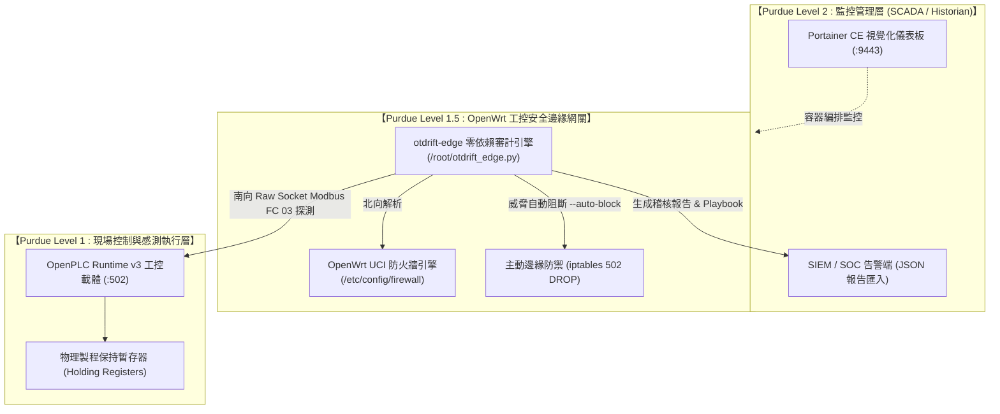

# 🛡️ otdrift : 工控邊緣組態語意飄移與物理不變量審計系統
### Edge-Native OT/ICS Configuration Drift & Invariant Auditor for Purdue Model Level 1.5

[](https://python.org)
[](https://opensource.org/licenses/MIT)
[](https://attack.mitre.org/matrices/ics/)
[]()
[-orange.svg)](https://openwrt.org)
[-brightgreen.svg)]()

> **otdrift** 是一套專為工業控制系統（OT / ICS）現場設計的**邊緣原生組態語意飄移與物理不變量審計系統**。
> 本系統針對 **ISA-95 / Purdue Model 第 1.5 層（邊緣安全閘道器）**，以獨創的 **加權樹狀語意編輯距離 ($D_{\text{W-STED}}$)** 與 **歸一化飄移指數 ($\text{NDI}$)** 數學模型，在 **零外部套件依賴** 的嚴苛邊緣路由器（OpenWrt）上實現雙軌動態感知：
> 1. **北向/閘道層**：即時解析 OpenWrt UCI 防火牆與轉發政策邊界。
> 2. **南向/現場層**：以 Raw Socket 探測 PLC Modbus TCP 保持暫存器（Holding Registers）之物理不變量。
> 3. **資安威脅自動對齊**：自動映射至 **MITRE ATT&CK for ICS** 矩陣（T0855、T0839 等），並動態生成可執行的現場應變處置手冊 (Incident Playbook) 與邊緣自動阻斷 (`--auto-block`)。

---

## ⚡ 教授 / 審查委員 1 分鐘快速測試指南 (Quick Demo)

若您想快速驗證本專案之核心功能與演算法，提供以下三種測試維度：

### 【Demo 1】10 秒本機一鍵單元測試（無需 Docker / 無需任何硬體）
```bash
# 1. 複製專案並安裝相依
git clone https://github.com/your-username/otdrift.git
cd otdrift
pip install -r requirements.txt

# 2. 執行全套 35 項單元測試（包含 W-STED 數學推導、UCI 解析器與規則引擎）
pytest
```
*預期結果：35/35 項測試於 0.3 秒內全數通過。*

---

### 【Demo 2】3 秒邊緣原生零依賴審計展示（模擬 OpenWrt 閘道器受駭）
不需啟動任何容器，直接執行獨立邊緣引擎比對受竄改的工控防火牆組態：
```bash
python openwrt/otdrift_edge.py -b configs/openwrt/baseline_firewall.uci -c configs/openwrt/tampered_firewall.uci
```
*預期結果：終端機立即以 ANSI 彩色表格跳出 **CRITICAL** 告警、計算出 W-STED 語意距離、對標至 **MITRE T0855 (Unauthorized Command Message)**，並打印出現場處置手冊！*

---

### 【Demo 3】實網工控容器雙軌攻防實驗（OpenWrt 網關 + OpenPLC v3 實體載體）
在 Linux (Ubuntu) 宿主機中執行真實工控拓撲：
```bash
# 啟動 Purdue 1.5 層隔離網路 (ot_carrier_net) 與容器群
docker compose -f docker/docker-compose.yml up -d

# 進入 OpenWrt 工控閘道器
docker exec -it ot_openwrt_gateway sh

# [在 OpenWrt 內] 匯出黃金標準基準線並驗證 0 飄移安全狀態 (綠字)
python3 /root/otdrift_edge.py --export-baseline /root/golden_baseline.json --modbus-host 172.28.0.50 --modbus-port 502
python3 /root/otdrift_edge.py -b /root/golden_baseline.json --live --modbus-host 172.28.0.50 --modbus-port 502

# [發動複合攻擊] 弱化網關防火牆 + 向下向 PLC 寫入危險超壓 140 psi
uci set firewall.@defaults[0].forward='ACCEPT' && uci commit firewall
python3 -c "import socket; s=socket.socket(); s.connect(('172.28.0.50', 502)); s.sendall(bytes([0,1,0,0,0,6,1,6,0,0,0,140])); s.recv(1024); s.close();"

# [執行即時雙軌審計]
python3 /root/otdrift_edge.py -b /root/golden_baseline.json --live --modbus-host 172.28.0.50 --modbus-port 502
```

**真實終端機輸出效果：**
```text
╔════════════════════════════════════════════════════════════════════════════╗
║          🛡️  otdrift-edge : OpenWrt 工控閘道器邊緣安全審計報告            ║
╚════════════════════════════════════════════════════════════════════════════╝
 • 審計評定 (Severity)     : CRITICAL
 • 飄移總數 (Total Drifts) : 2
 • W-STED 語意距離 (D)     : 5.00
 • 歸一化飄移指數 (NDI)    : 0.8647
 • 整體工控風險分值        : 86 / 100

┌───┬───────────────────────────────────────────┬────────┬────────┬──────┬─────────┐
│等 │ 參數路徑 (Parameter Path)                 │ 基準   │ 現況   │ 距離 │ MITRE   │
├───┼───────────────────────────────────────────┼────────┼────────┼──────┼─────────┤
│CRI│ firewall.defaults.defaults_0.forward        │ REJECT │ ACCEPT │ 2.00 │ T0855   │
│CRI│ process_registers.pump_cutoff_pressure_psi│   0    │  140   │ 3.00 │ T0839   │
└───┴───────────────────────────────────────────┴────────┴────────┴──────┴─────────┘

🚨 高危險飄移現場處置手冊 (Incident Playbook):
▶ [CRITICAL] firewall.defaults.defaults_0.forward (T0855 - Unauthorized Command Message)
   威脅說明：OpenWrt 防火牆邊界安全政策弱化！外部未授權流量可長驅直入或跨網段轉發。
   建議處置：執行 'uci set firewall.@defaults[0].forward=REJECT && uci commit firewall && /etc/init.d/firewall restart'。

▶ [CRITICAL] process_registers.pump_cutoff_pressure_psi (T0839 - Modify Parameter)
   威脅說明：現場 PLC 保持暫存器遭竄改 (0 -> 140)。實體設備面臨超壓、爆管或停機危險。
   建議處置：派員現場核實壓力閥門讀數，並透過 Modbus FC 06 還原為基準值 0。
```

---

## 📐 核心理論：加權樹狀語意編輯距離 (W-STED)

傳統資安比對工具（如 Git Diff、Tripwire）僅能輸出純文字差異，無法反映工控層級的物理危害。
本專案提出 **加權樹狀語意編輯距離 (Weighted Semantic Tree Edit Distance, W-STED)**：

$$D_{\text{W-STED}}(T_0, T_t) = \sum_{e \in \Delta(T_0, T_t)} w(\text{layer}(e)) \cdot \delta(v_0(e), v_t(e))$$

### 1. Purdue 工控階層權重階梯 $w(\text{layer})$
依據資安破壞對實體物理環境的衝擊程度賦予嚴格權重：
- **物理製程安全與不變量層 (Safety / Process Invariants)**：$w = 3.0$（壓力、轉速、急停設定）
- **閘道與工控協議層 (Gateway / Industrial Protocols)**：$w = 2.0$（Modbus、UCI 防火牆轉發政策）
- **管理與授權層 (Management / Authentication)**：$w = 1.5$（帳號、白名單）
- **基礎網路連線層 (Network)**：$w = 1.0$（DNS、NTP 設定）

### 2. 局部語意數值差異函數 $\delta(v_0, v_t)$
- **數值型參數 (Numerical Setpoints)**：採用相對擾動率 $\delta(v_0, v_t) = \min\left(1.0, \frac{|v_t - v_0|}{|v_0|}\right)$
- **集合/陣列型參數 (Whitelist / Access Lists)**：採用 Jaccard 語意距離 $\delta(A, B) = 1.0 - \frac{|A \cap B|}{|A \cup B|}$
- **布林與狀態型參數 (Discrete States)**：嚴格離散衝擊 $\delta(v_0, v_t) = \mathbb{I}(v_0 \neq v_t)$

### 3. 歸一化飄移指數 (Normalized Drift Index, NDI)
為提供標準化（$0.0 \sim 1.0$）與百萬級風險評分（$0 \sim 100$），採用平滑指數飽和函數：

$$\text{NDI} = 1.0 - e^{-\frac{D_{\text{W-STED}}}{\tau}}, \quad \text{其中飽和常數 } \tau = 2.5$$

---

## 🏗️ 系統架構圖 (Purdue Level 1.5 Architecture)



---

## 🗺️ MITRE ATT&CK for ICS 工控威脅對應矩陣

本專案規則引擎將常見飄移情境精準對齊至國際工控資安標準：

| 參數路徑 / 飄移事件 | 危害等級 | MITRE ATT&CK ID | 技術名稱 (Technique Name) | 現場威脅說明 |
| :--- | :---: | :---: | :--- | :--- |
| `firewall.defaults.forward = ACCEPT` | **CRITICAL** | **T0855** | Unauthorized Command Message | 網關邊界防護失效，跨網段惡意流量直接穿透 |
| `firewall.rules.*.src = wan (Port 502)` | **CRITICAL** | **T0855** | Unauthorized Command Message | 工控 Modbus 連接埠外曝網際網路 |
| `process_registers.pump_cutoff_pressure_psi` | **CRITICAL** | **T0839** | Modify Parameter | 現場 PLC 製程超壓竄改，實體管線面臨超壓危險 |
| `modbus_tcp.auth_required = false` | **CRITICAL** | **T0812** | Default Credentials | 工控通訊身分驗證被關閉，允許未授權主站連線 |
| `allow_remote_programming = true` | **CRITICAL** | **T0843** | Program Download | PLC 開啟未授權遠端邏輯階梯圖下載 |
| `firmware_version` 被降級 | **HIGH** | **T0857** | System Firmware | 設備遭降級至含有已知重大漏洞之舊版韌體 |

---

## 📂 專案目錄結構

```text
專題/
├── otdrift/                    # otdrift 核心模組庫
│   ├── core/                  # W-STED 距離計算、結構化比對器、路徑標準化
│   ├── parsers/               # OpenWrt UCI、JSON、YAML 解析器
│   ├── rules/                 # MITRE ATT&CK for ICS 規則評估引擎
│   ├── reporters/             # ANSI 終端機、視覺化 HTML、SIEM JSON 報告產出
│   └── cli.py                 # CLI 入口命令列工具
├── openwrt/                   # OpenWrt 原生邊緣閘道端專用程式
│   ├── otdrift_edge.py        # 零外部依賴獨立審計引擎（適用於嵌入式路由器）
│   ├── mock_plc.py            # 零依賴輕量 Modbus PLC 模擬器
│   └── README_OPENWRT.md      # OpenWrt 部署與實作技術指南
├── configs/                   # 黃金標準基準線與組態範本
│   ├── openwrt/               # baseline_firewall.uci, tampered_firewall.uci
│   └── swat/                  # SUTD SWaT 水處理測試情境組態
├── docker/                    # 虛擬工控測試載體 (OpenWrt + OpenPLC + Portainer)
│   ├── docker-compose.yml     # 容器拓撲配置檔
│   └── scripts/               # 部署與備份維運腳本
├── tools/                     # 自動化評測工具 (benchmark_swat.py, deploy_openwrt.sh)
├── tests/                     # 35 個自動化單元測試案例
├── pyproject.toml             # Python 專案配置
└── requirements.txt           # 本機開發相依套件清單
```

---

## ⚖️ 授權條款 (License)
本專案基於 [MIT License](LICENSE) 條款開源發布。適合學術研究、專案展示、工控資安演練與邊緣安全防禦實證。
