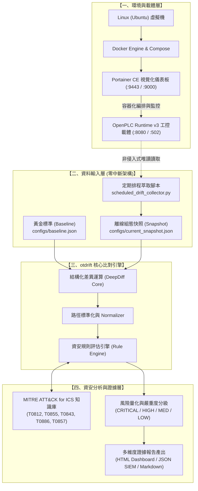

# 🛡 otdrift - OT/ICS 工控黃金標準設定飄移比對與 MITRE ATT&CK 稽核引擎

[]()
[]()
[]()
[]()

> **otdrift** 是一套專為工控 OT / ICS（Operational Technology / Industrial Control Systems）場域打造的**自動化組態飄移比對與資安風險對應引擎**。透過容器化載體（OpenPLC + Portainer）以及零中斷離線分析架構，在不影響產線可用性的前提下，精確碰撞出設備組態與黃金標準（Baseline）之差異，自動映射至 **MITRE ATT&CK for ICS** 矩陣，並產出具備證據溯源與處置建議的專業稽核報告。

---

## 📑 目錄

1. [系統架構與流程](#1-系統架構與流程)
2. [核心功能模組](#2-核心功能模組)
   - [一、環境架設與容器化管理 (Portainer + OpenPLC)](#一環境架設與容器化管理-結合-portainer)
   - [二、資料輸入層與 Baseline (黃金標準) 建立](#二資料輸入層與-baseline-黃金標準-建立)
   - [三、自動化飄移比對引擎 (otdrift CLI)](#三自動化飄移比對引擎-核心程式邏輯)
   - [四、資安風險對應與證據報告產出](#四資安風險對應與證據報告產出)
3. [目錄結構](#3-目錄結構)
4. [快速開始 (Quick Start)](#4-快速開始-quick-start)
5. [模擬攻擊與飄移測試情境](#5-模擬攻擊與飄移測試情境)
6. [排程自動化與 CI/CD 整合](#6-排程自動化與-cicd-整合)

---

## 1. 系統架構與流程



---

## 2. 核心功能模組

### 一、環境架設與容器化管理 (結合 Portainer)
- **Linux (Ubuntu) 底層環境**：提供 `docker/scripts/setup_ubuntu_docker.sh` 自動化腳本，一鍵安裝 Docker CE、配置使用者權限與 UFW 防火牆規則。
- **導入 Portainer 管理平台**：整合 Portainer CE 2.21+，提供網頁視覺化介面（HTTPS: 9443 / HTTP: 9000），輕鬆管理容器資源與磁碟卷。
- **部署 OT 工控載體**：透過 `docker/docker-compose.yml` 將虛擬工控環境（OpenPLC Runtime v3，Modbus TCP 502 / Web 8080）容器化部署。
- **備份與災難復原**：提供 `docker/scripts/backup_ot_carrier.sh`，自動備份 OpenPLC 階梯圖、設定與 Portainer 資料庫並計算 SHA-256 Checksum。

### 二、資料輸入層與 Baseline (黃金標準) 建立
- **零干擾離線分析架構 (Zero-Disruption OT Architecture)**：
  - 工控產線嚴禁對 live PLC 進行侵入式網路掃描（以免打斷 PLC 掃描週期或引發安全停機）。
  - 本架構透過排程讀取唯讀掛載磁碟卷或設定導出檔，達成 **0 網路負載、0 週期干擾** 的離線比對。
- **黃金標準設定檔 (`configs/baseline.json` & `baseline.yaml`)**：
  - 定義標準關鍵工控參數：IP、Modbus 通訊埠（502）、強制身分驗證（`auth_required`）、主站白名單（`allowed_master_ips`）、遠端存取與 Web 管理權限、韌體版本（`firmware_version`）、安全程式 SHA-256 指紋（`program_checksum`）以及唯讀暫存器保護範圍（`read_only_registers`）。

### 三、自動化飄移比對引擎 (核心程式邏輯 - `otdrift`)
- **模組化工具架構**：採用 clean architecture 設計，拆分為 `core/`、`rules/`、`reporters/` 與 `cli/`。
- **DeepDiff 結構化比對核心**：可精確碰撞出：
  - 數值變更 (`MODIFIED`)
  - 未授權新增參數 (`ADDED`)
  - 安全保護參數遭刪除 (`REMOVED`)
  - 型態變異 (`TYPE_CHANGED`)
  - 白名單陣列增減 (`LIST_CHANGED`)
- **豐富的 CLI 介面**：提供 `otdrift check`、`otdrift rules`、`otdrift mitre` 等命令，支援 CI/CD exit code 控制。

### 四、資安風險對應與證據報告產出
- **異常警報觸發**：當身分驗證被關閉、非預期埠號開放、遠端下載程式開啟或韌體版本降級時，即刻觸發高風險警報。
- **工控資安框架 (MITRE ATT&CK for ICS) 映射**：
  - `auth_required = false` ➔ **T0812 (Default Credentials) / T0855 (Unauthorized Command Message)**
  - `allow_remote_programming = true` ➔ **T0843 (Program Download)**
  - `modbus_tcp.port != 502` ➔ **T0885 (Commonly Used Port) / T0886 (Remote Services)**
  - `firmware_version downgraded` ➔ **T0857 (System Firmware) / T0839 (Modify Parameter)**
  - `read_only_registers altered` ➔ **T0836 (Modify Parameter - Safety)**
  - `plc_mode != RUN` ➔ **T0831 (Manipulation of Control)**
- **多格式結構化證據報告**：
  - **HTML Dashboard**：高質感互動式儀表板，具備嚴重度過濾、風險儀表與列印最佳化 CSS。
  - **JSON Report**：符合 SIEM / SOC 規範，帶有 SHA-256 雜湊與時間戳，可直接匯入 Wazuh / Splunk / ELK。
  - **Markdown Report**：包含資安衝擊分析與維運應變處置手冊 (Incident Playbook)。

---

## 3. 目錄結構

```text
專題/
├── configs/                            # 黃金標準與規則庫
│   ├── baseline.json                   # 黃金標準 (JSON)
│   ├── baseline.yaml                   # 黃金標準 (YAML)
│   └── rules.yaml                      # 自訂工控安全規則
├── docker/                             # 容器化與 Portainer 模組
│   ├── docker-compose.yml              # Portainer CE + OpenPLC Runtime v3
│   ├── README_PORTAINER.md             # Portainer 操作與部署完整手冊
│   └── scripts/
│       ├── setup_ubuntu_docker.sh      # Ubuntu Docker 一鍵安裝腳本
│       ├── deploy_portainer_and_ot.sh  # 啟動堆疊腳本
│       ├── backup_ot_carrier.sh        # 災難復原備份腳本
│       └── export_current_config.sh    # 零中斷離線快照擷取腳本
├── examples/                           # 測試範例與模擬情境
│   ├── scenarios/
│   │   ├── 01_normal_running.json      # 正常運作 (無飄移)
│   │   ├── 02_modbus_auth_disabled.json# 攻擊情境：關閉 Modbus 驗證
│   │   ├── 03_unauthorized_port_and_remote_access.json # 攻擊情境：未授權遠端存取
│   │   ├── 04_firmware_downgrade_and_tampered_registers.json # 韌體降級與程式竄改
│   │   └── 05_full_compromise.json     # 全面入侵複合攻擊
│   └── scheduled_drift_collector.py   # 自動化排程萃取與比對守護程式
├── otdrift/                            # 核心 Python 模組
│   ├── __init__.py
│   ├── cli.py                          # Click 命令列主程式
│   ├── core/
│   │   ├── comparator.py               # DeepDiff 結構化比對核心
│   │   ├── loader.py                   # JSON/YAML 載入與 SHA-256 雜湊計算
│   │   └── normalizer.py               # 路徑標準化與字典展開
│   ├── rules/
│   │   ├── default_rules.py            # 內建工控安全規則清單
│   │   ├── engine.py                   # 規則碰撞與評級引擎
│   │   └── mitre_ics.py                # MITRE ATT&CK for ICS 知識庫
│   └── reporters/
│       ├── base.py                     # 報告基底類別
│       ├── console_reporter.py         # Rich 彩色終端機報告
│       ├── html_reporter.py            # 視覺化 HTML 儀表板
│       ├── json_reporter.py            # SIEM 結構化 JSON 證據
│       └── markdown_reporter.py        # 完整稽核 Markdown 報告
├── tests/                              # 單元測試與整合測試 (Pytest)
│   ├── test_cli.py
│   ├── test_comparator.py
│   ├── test_loader.py
│   ├── test_mitre_mapping.py
│   ├── test_reporters.py
│   └── test_rules_engine.py
├── pyproject.toml                      # 現代化 Python 套件配置
├── requirements.txt                    # 專案相依套件清單
└── README.md                           # 本文件
```

---

## 4. 快速開始 (Quick Start)

### 1. 安裝環境與套件

```bash
# 建立虛擬環境並安裝相依套件
python -m venv .venv
source .venv/bin/activate  # Windows: .\.venv\Scripts\activate
pip install -e .
```

### 2. 檢視可用指令與規則庫

```bash
# 查看幫助說明
otdrift --help

# 查詢所有內建工控資安規則與對應技術
otdrift rules

# 查詢 MITRE ATT&CK for ICS 知識庫
otdrift mitre
```

### 3. 執行設定飄移檢測

```bash
# 比對黃金標準與現場快照 (終端機輸出)
otdrift check -b configs/baseline.json -c examples/scenarios/02_modbus_auth_disabled.json

# 產出視覺化 HTML 儀表板報告
otdrift check -b configs/baseline.json -c examples/scenarios/02_modbus_auth_disabled.json -f html -o reports/audit_result.html

# 產出機器可讀的 SIEM JSON 證據報告
otdrift check -b configs/baseline.json -c examples/scenarios/02_modbus_auth_disabled.json -f json -o reports/audit_evidence.json
```

---

## 5. 模擬攻擊與飄移測試情境

專案在 `examples/scenarios/` 內建 5 種常見的工控資安實戰情境：

| 情境檔案 | 模擬事件 | 偵測嚴重度 | MITRE ICS 技術 |
| :--- | :--- | :---: | :--- |
| `01_normal_running.json` | 正常運作，組態完全吻合 | **CLEAN** | 無 |
| `02_modbus_auth_disabled.json` | 關閉 Modbus 認證、新增萬用白名單 | **CRITICAL** | T0812, T0855 |
| `03_unauthorized_port_and_remote_access.json` | 竄改監聽埠、開啟遠端階梯圖修改 | **CRITICAL** | T0843, T0886, T0885 |
| `04_firmware_downgrade_and_tampered_registers.json` | 韌體降級、程式雜湊不符、停機 | **CRITICAL** | T0857, T0843, T0831, T0836 |
| `05_full_compromise.json` | 複合式多層級全毀入侵 | **CRITICAL** | 複合多項技術 |

---

## 6. 排程自動化與 CI/CD 整合

### 1. 離線排程守護程式 (`scheduled_drift_collector.py`)

在維運伺服器中以守護程式（Daemon）方式定期無感執行：

```bash
# 每 60 秒定期離線稽核一次，自動產出時間戳審計報告至 reports/
python examples/scheduled_drift_collector.py -b configs/baseline.json -c configs/current_snapshot.json --loop --interval 60
```

### 2. CI/CD 與自動化警報門檻 (`--fail-on`)

`otdrift` 支援在偵測到特定風險以上時返回 `exit code 1`，可無縫整合至 GitLab CI / GitHub Actions / Jenkins：

```bash
# 若飄移達到 HIGH 或 CRITICAL 等級，自動阻斷部署並發出警報
otdrift check -b configs/baseline.json -c configs/current_snapshot.json --fail-on HIGH
```
- **Exit Code 0**：通過檢測（無飄移或風險低於門檻）
- **Exit Code 1**：安全違規（風險達到或超過指定門檻）
- **Exit Code 2**：輸入檔案錯誤或解析失敗

---

## 7. 授權與宣告 (License)
本專案遵循 MIT License 開源授權，適合學術專題研究、實驗室 OT 資安驗證與工業控制安全防禦演練。
