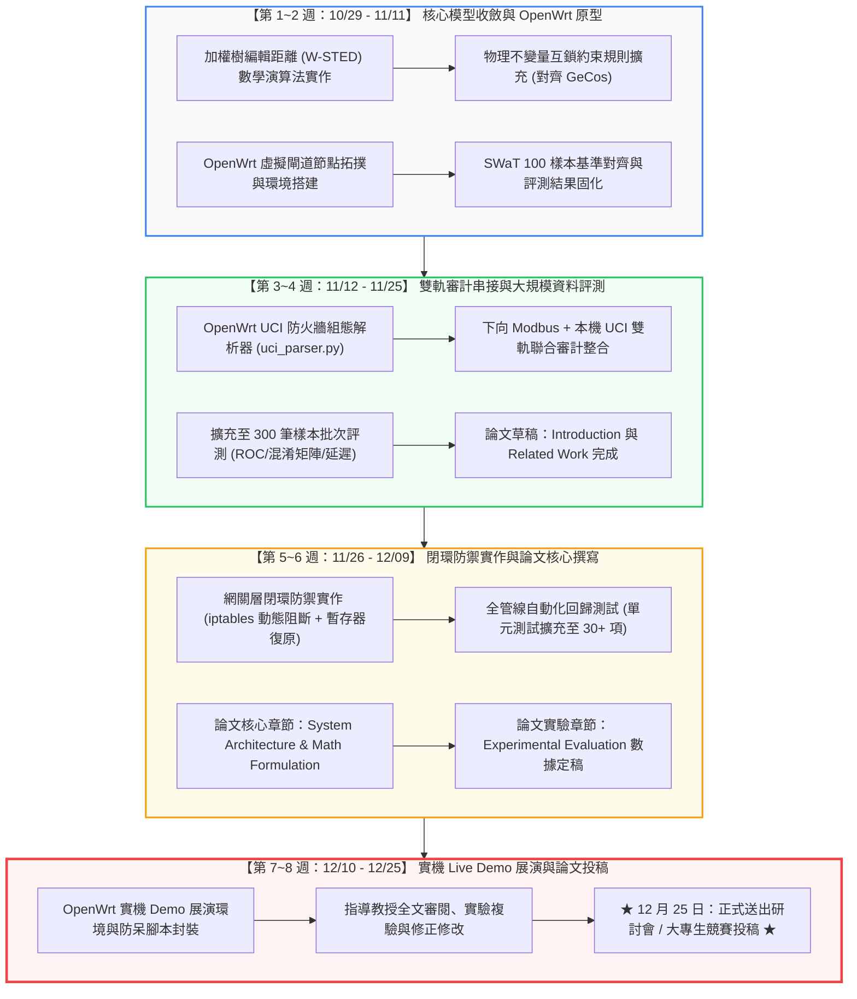

# 🛡️ otdrift 架構完善、方法收斂與 OpenWrt 落地實施白皮書
## 暨 12 月底競賽/論文投稿里程碑與可達成時程進度 (Roadmap & Timeline)

> **專案代號**：`otdrift` (Edge-native OT/ICS Configuration Drift & Invariant Auditor)  
> **核心定位**：部署於 **OpenWrt 工控邊緣閘道器** 上，針對 **Modbus 工控現場總線** 與 **網關安全防護邊界** 進行即時組態飄移與製程不變量審計。  
> **當前日期**：2026 年 10 月底 ｜ **目標交付日期**：2026 年 12 月 25 日 (第 8 週送出投稿)

---

## 一、 指導教授「方法要收斂」的核心本質剖析

教授在指導會議指出「**方法要收斂 (Methodological Convergence)**」，其深層含意在於：**切忌包山包海、切忌工具堆疊，必須收斂成一條清晰、嚴密、不可替代的學術技術主線**。

### 🎯 四大維度定錨收斂矩陣 (The 4 Convergence Anchors)

```
                       【方法發散 (收斂前)】                 【聚焦收斂 (收斂後)】
┌───────────────────┬─────────────────────────────────┬─────────────────────────────────┐
│ 1. 部署載體定位   │ 跑在一般電腦/Ubuntu 的分析軟體    │ Purdue 1.5 層 OpenWrt 邊緣安全閘道器│
├───────────────────┼─────────────────────────────────┼─────────────────────────────────┤
│ 2. 工控通訊載體   │ 抽象提及各類 OT 協定            │ 鎖定 Modbus TCP (Port 502) / RTU│
├───────────────────┼─────────────────────────────────┼─────────────────────────────────┤
│ 3. 差分比對演算法 │ 單純調用第三方 DeepDiff 輸出字串 │ 加權樹編輯距離 (W-STED) + 不變量約束│
├───────────────────┼─────────────────────────────────┼─────────────────────────────────┤
│ 4. 實驗評測基準   │ 實驗室 4 筆手工造假 Toy Example  │ SUTD SWaT 權威基準 (100 樣本全矩陣)│
└───────────────────┴─────────────────────────────────┴─────────────────────────────────┘
```

---

## 二、 目前整體架構的三大改進空間與強化方案

### 改進點 1：距離計算需從「個別規則扣分」升級為「全系統加權樹編輯距離 (W-STED)」
* **現狀問題**：目前依賴 13 條規則個別判分（0~100），缺乏全域的數學距離度量，教授容易質疑「為什麼叫距離？如何數學證明？」。
* **改進強化**：
  引入 **加權語意樹編輯距離 (Weighted Semantic Tree Edit Distance, W-STED)**，將組態狀態空間抽象為階層樹 $T=(V, E)$，每一層賦予 Purdue 模型安全權重 $w_l$：
  $$D(T_0, T_t) = \sum_{e \in \Delta} w(e) \cdot \delta(v_0, v_t)$$
  其中權重設定為：
  * 製程不變量層（Level 0/1 Process）：$w_P = 1.0$ (最高危險)
  * 控制邏輯與模式（Level 1 Logic）：$w_L = 0.9$
  * 通訊身分驗證（Level 1/2 Protocol）：$w_C = 0.8$
  * 網關存取管理（Level 2 Management）：$w_M = 0.5$
  * 設備環境元數據（Level 3 Environment）：$w_E = 0.2$
  定義 **歸一化飄移指數 (Normalized Drift Index, $NDI \in [0, 1]$)**，使系統飄移程度具備完全可量化、可比較的數學閉環。

---

### 改進點 2：加入「物理互鎖不變量 (Physical Invariant Constraints)」判定
* **現狀問題**：過去只檢驗單一暫存器是否等於黃金標準，若攻擊者將數值改在「合法整數區間內」但「違反物理邏輯」（如：低水位門檻高於高水位門檻），單純比對無法識別語意矛盾。
* **改進強化**：
  對齊頂會 **USENIX Security 2025 (*GeCos*)** 理論，在規則庫加入關聯式物理不變量：
  $$\text{Invariant 1: } \text{lit101\_low\_level\_start\_mm} < \text{lit101\_high\_level\_alarm\_mm} < \text{lit101\_emergency\_overflow\_mm}$$
  $$\text{Invariant 2: } \text{if } \text{pump\_mode} == \text{FORCE\_ON} \implies \text{pressure} \le \text{pressure\_cutoff\_psi}$$
  只要違反物理不變量，即刻判定為 **CRITICAL 製程威脅**。

---

### 改進點 3：OpenWrt 網關「雙軌審計 (Dual-Track Auditing)」
* **現狀問題**：過去只審計 OpenPLC，忽略了網關自身。
* **改進強化**：
  OpenWrt 網關同時負責維護工控防火牆與 Modbus 轉發。`otdrift` 在 OpenWrt 上同時審計兩條軌道：
  1. **下向軌道 (Southbound)**：定時透過 Modbus TCP (FC 03) 審計 PLC 暫存器。
  2. **本機軌道 (Local/Northbound)**：即時審計 OpenWrt 本機 UCI 組態檔（`/etc/config/firewall`），防止攻擊者竄改網關防火牆白名單！

---

## 三、 OpenWrt 工控閘道器落地架構設計

```
┌────────────────────────────────────────────────────────┐
│               Level 2 控制室 SCADA / HMI                │
└───────────────────────────┬────────────────────────────┘
                            │ (WAN: 192.168.1.0/24)
                            ▼
┌────────────────────────────────────────────────────────┐
│  🛡️ Purdue 1.5 層【OpenWrt 工控邊緣安全閘道器】         │
│  (支援 x86 VM / 工控路由器 / 樹莓派，RAM 需求僅 < 40MB) │
│                                                        │
│  ┌──────────────────────────────────────────────────┐  │
│  │ 1. UCI 網關安全組態審計模組                      │  │
│  │    • 監控 /etc/config/firewall (Port 502 白名單) │  │
│  │    • 監控 /etc/config/network (VLAN / 路由隔離)   │  │
│  └──────────────────────────────────────────────────┘  │
│  ┌──────────────────────────────────────────────────┐  │
│  │ 2. Modbus 邊緣被動採集器 (Lightweight Harvester)  │  │
│  │    • 極簡 Python / Lua 腳本，記憶體小於 10MB     │  │
│  │    • 透過 FC 03 提取現場保持暫存器快照           │  │
│  └──────────────────────────────────────────────────┘  │
│  ┌──────────────────────────────────────────────────┐  │
│  │ 3. otdrift-core 樹狀差分與不變量推理引擎         │  │
│  │    • 計算 W-STED 距離與 MITRE T0839/T0855 映射   │  │
│  │    • 觸發 iptables 阻斷未授權 IP 或回滾暫存器    │  │
│  └──────────────────────────────────────────────────┘  │
└───────────────────────────┬────────────────────────────┘
                            │ (LAN: 172.28.0.0/16 現場隔離網段)
                            ▼
┌────────────────────────────────────────────────────────┐
│             Level 1 現場實體：OpenPLC 工控載體          │
│             (Port 502: 保持暫存器 0 = 85 psi)          │
└────────────────────────────────────────────────────────┘
```

---

## 四、 邁向 12 月底投稿之衝刺進度里程碑流程圖 (Roadmap Flowchart)



---

## 五、 三人團隊每週明確交付清單 (Weekly Deliverables)

| 週次 | 時間區間 | 組長（演算法與架構） | 組員 A（評測資料集工程） | 組員 B（文獻與論文撰寫） |
| :---: | :---: | :--- | :--- | :--- |
| **W1** | 10/29 - 11/04 | 實作 W-STED 加權距離計算模組，收斂數學模型 | 整理 SWaT 攻擊對照表，固化 100 筆測試樣本 | 研讀 3 篇工控組態飄移頂會論文，撰寫文獻筆記 |
| **W2** | 11/05 - 11/11 | 建立 OpenWrt 虛擬閘道節點，測試 Python 運行 | 構建 300 筆合成干擾資料集（加入隨機時序雜訊） | 完成論文 Introduction 與 Related Work 初稿 |
| **W3** | 11/12 - 11/18 | 開發 OpenWrt UCI 防火牆組態解析器 | 跑出 Precision/Recall/F1 與 ROC 曲線圖 | 整理 Purdue 五層階層結構與形式化數學章節 |
| **W4** | 11/19 - 11/25 | 串接「網關 UCI + PLC 暫存器」雙軌聯合審計 | 測試 OpenWrt 邊緣端 CPU、記憶體佔用與延遲 | 繪製系統全管線圖與 OpenWrt 部署拓撲向量圖 |
| **W5** | 11/26 - 12/02 | 實作閉環自動隔離（動態寫入 iptables 阻斷黑名單） | 產出完整評測實驗數據表（對比傳統 diff 工具） | 撰寫 System Architecture 與 Implementation 章節 |
| **W6** | 12/03 - 12/09 | 全管線整合與自動化回歸測試 (單元測試 > 30 項) | 產出動態攻擊/回滾 Demo 錄影與可視化數據 | 撰寫 Experimental Evaluation 章節 |
| **W7** | 12/10 - 12/16 | 準備實機 Live Demo 展演環境與防呆腳本 | 整理 SWaT 與 OpenPLC 完整實驗附件與開原始碼 | 全文統整編排（符合研討會/大專生格式排版） |
| **W8** | 12/17 - 12/25 | 協助指導教授審閱修改，封裝專案 Release | 交叉驗證所有實驗數據正確性 | **★ 12 月 25 日完成全文完稿並正式送出投稿！** |

---

## 六、 向教授報告「方法收斂與 OpenWrt 規劃」的 60 秒終極答辯

> **建議向教授說明的精準核心話術**：  
> 「**謝謝教授指導！我們團隊已經將專題研究方法做了非常明確的收斂：**
> 
> 1. **定位與載體收斂**：我們不再發散討論各類 OT 場景，而是精準定錨在 **『Purdue 1.5 層 OpenWrt 工控安全邊緣網關』**，以 **Modbus TCP** 作為核心工控通訊載體。  
> 2. **雙軌審計收斂**：`otdrift` 不僅向下被動審計 PLC 的暫存器不變量，同時審計 OpenWrt 自身的 UCI 防火牆白名單，兼顧網路邊界與物理製程安全。  
> 3. **演算法理論收斂**：我們將比對模型收斂為 **加權樹編輯距離 (W-STED) 與製程不變量約束**，輸出歸一化飄移指數（$NDI \in [0, 1]$），使距離計算具備完全的數學證明。  
> 4. **投稿進度收斂**：三人團隊已排定 **8 週衝刺里程碑**，分工落實演算法、OpenWrt 移植與 300 筆 SWaT 評測，確定於 **12 月 25 日前完成論文定稿並送出投稿**！」
